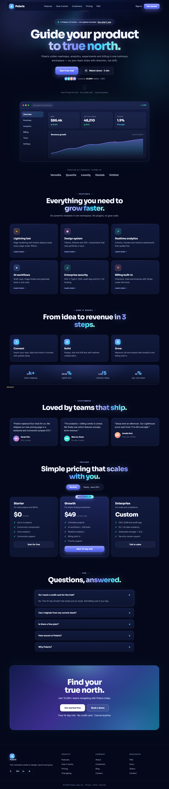
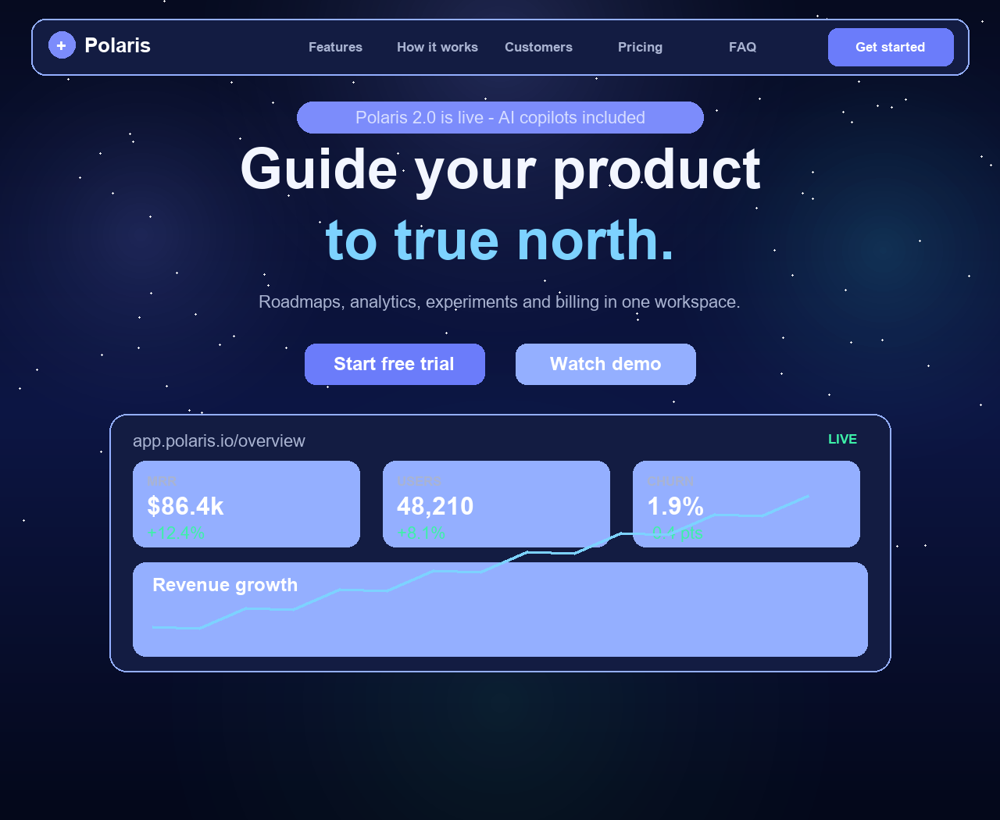
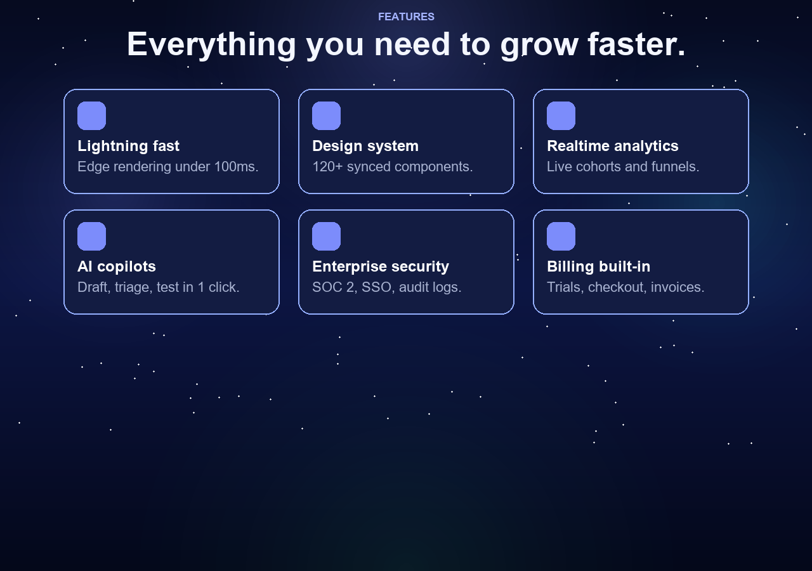
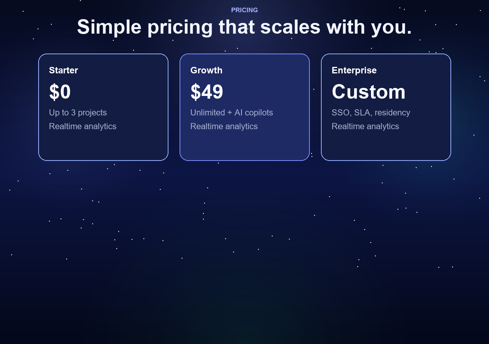

# ✦ Polaris — Guide your product to true north

A premium aurora-theme landing page for **Polaris**, a fictional product
command center (roadmaps, analytics, experiments, billing).
Pure HTML + CSS + JS — no frameworks, no build step.

## ✨ Preview

Full-page render of the live site.

Section close-ups live in `screenshots/`:

| Hero + dashboard | Features + workflow |
|---|---|
|  |  |

| Pricing + FAQ |
|---|
|  |

## Features

- Floating glass navbar with scroll progress + mobile menu
- Aurora hero (animated beam, twinkling stars, gradient headline) + social proof
- Glass dashboard mockup with KPIs, revenue chart, glowing border
- Logo strip, 6-card features grid, 3-step method, gradient stats band
- Testimonials, monthly/yearly pricing toggle, FAQ accordion, CTA + footer
- Scroll-reveal animations, animated counters, smooth scrolling, toast
- Fully responsive down to 360 px

## Structure

~~~
polaris/
  index.html       - markup (sections in document order)
  styles.css       - Polaris aurora theme (variables, glass, breakpoints)
  script.js        - navbar, menu, reveal, counters, toggle, FAQ, toast
  screenshot.png   - full-page screenshot of the real rendered page
  screenshots/     - hero.png, features.png, pricing.png (section crops)
  tools/           - cap_full.py (full-page capture), shoot.py (all shots)
  README.md        - this file
~~~

HTML, CSS and JS are kept in **separate files**.

## Run locally

Option 1 - open directly:

1. Open `polaris/index.html` in any modern browser.

Option 2 - serve over HTTP (recommended):

~~~bash
cd polaris
python -m http.server 8000
# then visit http://localhost:8000
~~~

No dependencies required.

## Customise

- Colours / fonts: edit the `:root` variables at the top of `styles.css`.
- Copy: all section text lives in `index.html`.
- Behaviour: menu + reveal logic lives in `script.js`.
